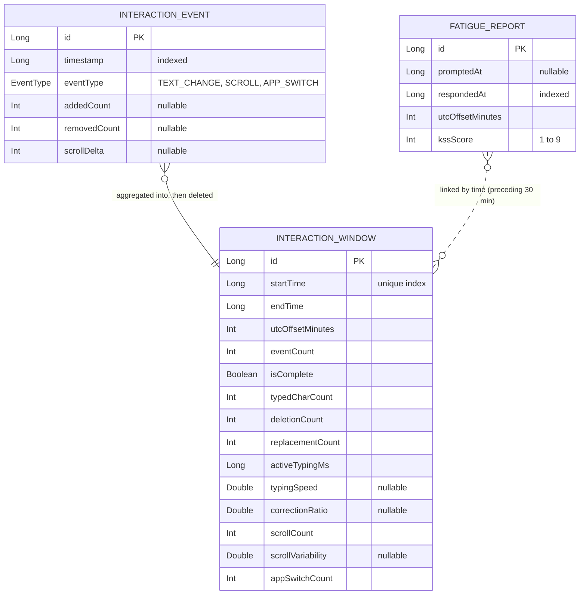

# Burnout Detector — Database Design

## 1. Overview

The Burnout Detector application uses Room, an abstraction layer over SQLite, for local storage of behavioral measurements and self-reported fatigue ratings. The database file is stored in the application's private storage and is never transmitted automatically (NFR02).

The database is designed to:

- minimize sensitive data collection: no text, passwords, screenshots, or application package names are stored (NFR01);
- support five-minute feature aggregation (FR08);
- support personalized baseline calculation and anomaly detection (FR14–FR15);
- preserve enough information for the research evaluation (RQ2, RQ3), including data-quality checks and participant response rates.

## 2. Entity-Relationship Diagram

The relationships are **logical, not foreign keys**. Events are deleted after aggregation, and fatigue reports are matched to windows by timestamp during analysis, so no stored row references another.

## 3. Database Entities

### 3.1. InteractionEvent (temporary)

Stores sanitized metadata for one accepted accessibility event. Records exist only until they are aggregated into a window (see Section 6).

| Field | Type | Nullable | Description |
|---|---|---|---|
| `id` | Long | No | Primary key, auto-generated |
| `timestamp` | Long | No | Event time in epoch milliseconds (UTC). Indexed |
| `eventType` | `EventType` | No | Enum: `TEXT_CHANGE`, `SCROLL`, `APP_SWITCH`. Stored via a Room `TypeConverter` |
| `addedCount` | Int | Yes | Characters added (text-change events only) |
| `removedCount` | Int | Yes | Characters removed (text-change events only) |
| `scrollDelta` | Int | Yes | Vertical scroll distance in pixels, where the device reports it (API 28+) |

The event stores raw counts only. Whether a text change is a typed character, a deletion, or a replacement is decided during aggregation, so the classification rules can be refined without changing the stored data.

No text content, passwords, screenshots, or application package names are stored. For `APP_SWITCH`, the record only states that a switch occurred.

### 3.2. InteractionWindow

Stores features computed from the events of one five-minute interval. This is the main table used for baseline calculation, anomaly detection, and analysis.

| Field | Type | Nullable | Description |
|---|---|---|---|
| `id` | Long | No | Primary key, auto-generated |
| `startTime` | Long | No | Window start, epoch ms (UTC). Unique index |
| `endTime` | Long | No | Window end, epoch ms (UTC) |
| `utcOffsetMinutes` | Int | No | Device time-zone offset, for time-of-day analysis |
| `eventCount` | Int | No | Number of accepted events in the window |
| `isComplete` | Boolean | No | `false` if monitoring was not active for the whole window (e.g., service restarted) |
| `typedCharCount` | Int | No | Characters typed (single-character additions) |
| `deletionCount` | Int | No | Deletion events (`removedCount > 0`, `addedCount = 0`) |
| `replacementCount` | Int | No | Multi-character replacements, e.g., autocorrect or word suggestions |
| `activeTypingMs` | Long | No | Time spent actively typing; pauses above a threshold are excluded |
| `typingSpeed` | Double | Yes | Characters per minute of active typing. `null` if no typing occurred |
| `correctionRatio` | Double | Yes | `deletionCount / (typedCharCount + deletionCount)`. `null` if no typing occurred |
| `scrollCount` | Int | No | Number of scroll events |
| `scrollVariability` | Double | Yes | Standard deviation of scroll distances. `null` if fewer than two scroll events had a distance |
| `appSwitchCount` | Int | No | Number of application switches |

**Null versus zero.** Unavailable features are represented as `null`, not zero. A window without typing has an *unknown* typing speed, not a speed of zero; treating it as zero would distort baselines and statistics.

**Counts alongside ratios.** Ratios computed from very little data are unreliable (e.g., one deletion out of two characters gives a ratio of 0.5). Storing the underlying counts allows the analysis to exclude windows below a minimum amount of activity (e.g., fewer than 20 typed characters) and to recompute ratios if definitions change. Exact feature definitions and thresholds are specified in [`../month-3/feature-extraction.md`](../month-3/feature-extraction.md).

### 3.3. FatigueReport

Stores subjective fatigue ratings entered by participants (FR09).

| Field | Type | Nullable | Description |
|---|---|---|---|
| `id` | Long | No | Primary key, auto-generated |
| `promptedAt` | Long | Yes | When the rating notification was shown. `null` if the user rated on their own initiative |
| `respondedAt` | Long | No | When the rating was submitted, epoch ms (UTC). Indexed |
| `utcOffsetMinutes` | Int | No | Device time-zone offset |
| `kssScore` | Int | No | Karolinska Sleepiness Scale score, 1 (extremely alert) to 9 (very sleepy, fighting sleep) |

The Karolinska Sleepiness Scale is a validated single-item scale, which keeps each prompt quick for participants. Recording `promptedAt` separately from `respondedAt` allows the study to report response rates and response delays.

## 4. Linking Fatigue Reports to Windows

Fatigue reports are stored independently. During analysis, each report is associated with the `InteractionWindow` records whose `endTime` falls within the 30 minutes before `respondedAt`. Only complete windows (`isComplete = true`) with sufficient activity are used.

## 5. Indexes

| Table | Index | Reason |
|---|---|---|
| `InteractionEvent` | `timestamp` | Aggregation selects events by time range |
| `InteractionWindow` | `startTime` (unique) | Prevents duplicate windows; supports time-range queries |
| `FatigueReport` | `respondedAt` | Linking reports to windows by time |

## 6. Aggregation and Recovery

Every five minutes, the events of the closed window are read, the features are computed, and the window is stored. The insertion of the window and the deletion of its events are performed inside a **single Room `@Transaction`**: if the process is interrupted, either both operations complete or neither does. As a result, events are never lost and never counted twice.

Because `startTime` has a unique index, an attempt to store the same window twice is rejected. After an interruption, any remaining events are aggregated into their windows on the next run, and those windows are marked `isComplete = false` if monitoring was not active throughout.

## 7. Privacy and Retention

- All records are stored in the application's private local database.
- Text content, passwords, screenshots, and application package names are never stored.
- `InteractionEvent` records are deleted as soon as they are aggregated (NFR09).
- Users can explicitly export their data (FR13) and delete all local data at any time (FR12).
- Participants' data is retained only for the duration of the study.

## 8. Settings Stored Outside the Database

Small configuration values are stored with Jetpack DataStore rather than Room, because they are single values rather than records:

| Setting | Purpose |
|---|---|
| `participantCode` | Pseudonymous identifier (e.g., `P03`) included in exports, so that files from different participants can be combined without names |
| `consentAcceptedAt` | When the user accepted the information screen (FR01) |
| `monitoringEnabled` | Whether the user has paused monitoring (FR11) |
| Diagnostics counters | Number of skipped or malformed events (NFR04) |

## 9. Export Format

Export (FR13) produces CSV files for `InteractionWindow` and `FatigueReport`, one row per record, with the participant code added as the first column. Temporary `InteractionEvent` records are not exported.

## 10. Future Extensions

Month 4 will add storage for personalized baseline statistics (e.g., per-feature median and spread) and anomaly scores per window, to support the detection logic (FR14–FR15).