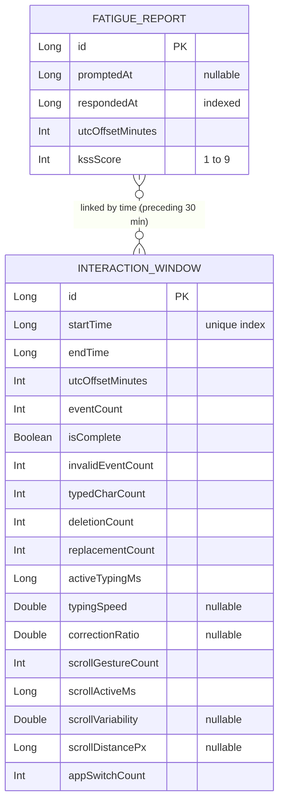

# Burnout Detector — Database Design

## 1. Overview

The Burnout Detector application uses Room, an abstraction layer over SQLite, for local storage of behavioral measurements and self-reported fatigue ratings. The database file is stored in the application's private storage and is never transmitted automatically (NFR02).

The database is designed to:

- minimize sensitive data collection: no text, passwords, screenshots, or application package names are stored (NFR01);
- never persist individual interaction events: events are counted in memory and only five-minute summaries are written to disk (see Section 3.1);
- support five-minute feature aggregation (FR08);
- support personalized baseline calculation and anomaly detection (FR14–FR15);
- preserve enough information for the research evaluation (RQ2, RQ3), including data-quality checks and participant response rates.

## 2. Entity-Relationship Diagram

The relationship is **logical, not a foreign key**: fatigue reports are matched to windows by timestamp during analysis, so no stored row references another.

## 3. Database Entities

### 3.1. In-Memory Window Accumulator (not persisted)

Individual accessibility events are **never written to the database**. While a five-minute window is open, the service keeps only running totals in memory: the counters listed in Section 3.2, the time of the last text-change event (to measure active typing time), the state of the current scroll gesture, and the last foreground application with the time it came to the front (to detect application switches). When the window closes, the totals are converted into one `InteractionWindow` row and the in-memory state is reset.

**Rationale (device testing, Month 2).** Testing showed that Android does not reliably mark password fields: on a web-based sign-in screen and on a third-party application's custom login screen, characters typed into password fields were delivered as ordinary text-change events (see `testing-report.md`, Section 8.6). The event text is never read, but a sequence of stored per-event records with timestamps would reveal the **length and typing rhythm of a password**. Aggregating in memory removes this risk: a password of a few characters disappears into the window totals and cannot be recovered.

**Trade-off.** If the process is stopped, at most the current window (up to five minutes) is lost. Such windows are not stored; the next window is marked `isComplete = false` if monitoring started part-way through it (Section 6).

Each text-change event is classified by its net change, `addedCount − removedCount`, because some keyboards and applications report a whole word being replaced on every keystroke rather than single characters:

| Net change | Classification |
|---|---|
| +1 | Typed character |
| −1 | Deletion |
| 0 | Not a keystroke (e.g., composing-text or formatting update); ignored |
| > +1 or < −1 | Replacement (autocorrect, suggestion, paste, or field clearing) |
| Invalid value (e.g., `removedCount = −1`) | Skipped and counted in `invalidEventCount` |

### 3.2. InteractionWindow

Stores features computed from the events of one five-minute interval. This is the main table used for baseline calculation, anomaly detection, and analysis.

| Field | Type | Nullable | Description |
|---|---|---|---|
| `id` | Long | No | Primary key, auto-generated |
| `startTime` | Long | No | Window start, epoch ms (UTC). Unique index |
| `endTime` | Long | No | Window end, epoch ms (UTC) |
| `utcOffsetMinutes` | Int | No | Device time-zone offset, for time-of-day analysis |
| `eventCount` | Int | No | Number of accepted events in the window |
| `isComplete` | Boolean | No | `false` if monitoring was not active for the whole window (e.g., service restarted) |
| `invalidEventCount` | Int | No | Events skipped because of missing or invalid values (NFR04) |
| `typedCharCount` | Int | No | Text changes with a net change of +1 |
| `deletionCount` | Int | No | Text changes with a net change of −1 |
| `replacementCount` | Int | No | Text changes with a net change above +1 or below −1 (autocorrect, suggestions, paste, clearing) |
| `activeTypingMs` | Long | No | Time spent actively typing; pauses above a threshold are excluded |
| `typingSpeed` | Double | Yes | Characters per minute of active typing. `null` if no typing occurred |
| `correctionRatio` | Double | Yes | `deletionCount / (typedCharCount + deletionCount)`. `null` if no typing occurred |
| `scrollGestureCount` | Int | No | Number of scroll gestures. Scroll events less than about 300 ms apart are grouped into one gesture, because Android delivers continuous scrolling as a stream of events roughly every 100 ms |
| `scrollActiveMs` | Long | No | Total duration of scroll gestures |
| `scrollVariability` | Double | Yes | Standard deviation of scroll gesture durations. `null` if fewer than two gestures occurred |
| `scrollDistancePx` | Long | Yes | Total absolute scroll distance, only from applications that report it. `null` if no application in the window reported a distance |
| `appSwitchCount` | Int | No | Number of switches to a different application that stayed in the foreground for at least about one second. The launcher and system overlays are not counted as applications |

**Null versus zero.** Unavailable features are represented as `null`, not zero. A window without typing has an *unknown* typing speed, not a speed of zero; treating it as zero would distort baselines and statistics.

**Counts alongside ratios.** Ratios computed from very little data are unreliable (e.g., one deletion out of two characters gives a ratio of 0.5). Storing the underlying counts allows the analysis to exclude windows below a minimum amount of activity (e.g., fewer than 20 typed characters) and to recompute ratios if definitions change. Exact feature definitions and thresholds are specified in [`../month-3/feature-extraction.md`](../month-3/feature-extraction.md).

### 3.3. FatigueReport

Stores subjective fatigue ratings entered by participants (FR09).

| Field | Type | Nullable | Description |
|---|---|---|---|
| `id` | Long | No | Primary key, auto-generated |
| `promptedAt` | Long | Yes | When the rating notification was shown. `null` if the user rated on their own initiative |
| `respondedAt` | Long | No | When the rating was submitted, epoch ms (UTC). Indexed |
| `utcOffsetMinutes` | Int | No | Device time-zone offset |
| `kssScore` | Int | No | Karolinska Sleepiness Scale score, 1 (extremely alert) to 9 (very sleepy, fighting sleep) |

The Karolinska Sleepiness Scale is a validated single-item scale, which keeps each prompt quick for participants. Recording `promptedAt` separately from `respondedAt` allows the study to report response rates and response delays.

## 4. Linking Fatigue Reports to Windows

Fatigue reports are stored independently. During analysis, each report is associated with the `InteractionWindow` records whose `endTime` falls within the 30 minutes before `respondedAt`. Only complete windows (`isComplete = true`) with sufficient activity are used.

## 5. Indexes

| Table | Index | Reason |
|---|---|---|
| `InteractionWindow` | `startTime` (unique) | Prevents duplicate windows; supports time-range queries |
| `FatigueReport` | `respondedAt` | Linking reports to windows by time |

## 6. Aggregation and Recovery

Every five minutes, the in-memory totals of the closed window are converted into features and stored as one `InteractionWindow` row, and the accumulator is reset. Because only one row is written per window, no multi-step transaction is needed.

Because `startTime` has a unique index, an attempt to store the same window twice is rejected. If the process is stopped, the in-memory totals of the open window are lost and that window is not stored. When monitoring resumes part-way through a window, that window is marked `isComplete = false`. Windows in which monitoring was paused are not stored.

## 7. Privacy and Retention

- All records are stored in the application's private local database.
- Text content, passwords, screenshots, and application package names are never stored.
- Individual interaction events are never stored; they exist only in memory until their window closes (NFR09).
- Users can explicitly export their data (FR13) and delete all local data at any time (FR12).
- Participants' data is retained only for the duration of the study.

## 8. Settings Stored Outside the Database

Small configuration values are stored with Jetpack DataStore rather than Room, because they are single values rather than records:

| Setting | Purpose |
|---|---|
| `participantCode` | Pseudonymous identifier (e.g., `P03`) included in exports, so that files from different participants can be combined without names |
| `consentAcceptedAt` | When the user accepted the information screen (FR01) |
| `monitoringEnabled` | Whether the user has paused monitoring (FR11) |
| Diagnostics counters | Number of skipped or malformed events (NFR04) |

## 9. Export Format

Export (FR13) produces CSV files for `InteractionWindow` and `FatigueReport`, one row per record, with the participant code added as the first column.

## 10. Future Extensions

Month 4 will add storage for personalized baseline statistics (e.g., per-feature median and spread) and anomaly scores per window, to support the detection logic (FR14–FR15).
