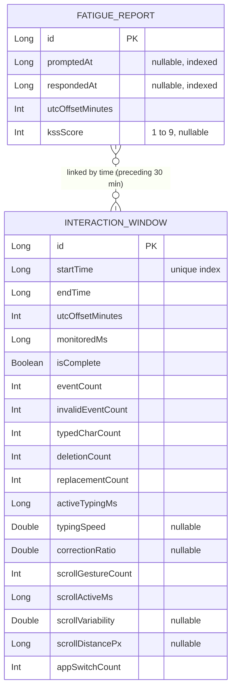

# Burnout Detector — Database Design

## 1. Overview

The Burnout Detector application uses Room, an abstraction layer over SQLite, for local storage of behavioral measurements and self-reported fatigue ratings. The database file is stored in the application's private storage and is never transmitted automatically (NFR02).

The database is designed to:

- minimize sensitive data collection: no text, passwords, screenshots, or application package names are stored (NFR01);
- never persist individual interaction events: events are counted in memory and only five-minute summaries are written to disk (see Section 3.1);
- support feature aggregation in fixed, non-overlapping five-minute windows (FR08; see Section 3.2);
- support personalized baseline calculation and anomaly detection (FR14–FR15);
- preserve enough information for the research evaluation (RQ2, RQ3), including data-quality checks and participant response rates.

## 2. Entity-Relationship Diagram

The relationship is **logical, not a foreign key**: fatigue reports are matched to windows by timestamp during analysis, so no stored row references another.

## 3. Database Entities

### 3.1. In-Memory Window Accumulator (not persisted)

Individual accessibility events are **never written to the database**. While a five-minute window is open, the service keeps only running totals in memory: the counters listed in Section 3.2, the time of the last text-change event (to measure active typing time), the state of the current scroll gesture, and the last foreground application with the time it came to the front (to detect application switches). When the window closes, the totals are converted into one `InteractionWindow` row and the in-memory state is reset.

**Rationale (device testing, Month 2).** Testing showed that Android does not reliably mark password fields: on the Google account sign-in screen and on a third-party application's custom login screen, typing in password fields produced ordinary text-change events that were not flagged by `isPassword()` (see `testing-report.md`, Section 8.6). Android includes the changed text in such events, so the event objects delivered to the service may contain password characters. The application never reads, logs, or stores event text, but a sequence of stored per-event records with timestamps would reveal the **length and typing rhythm of a password**.

Aggregating in memory **reduces** this risk but does not remove it completely. In a window that contains other typing, a short input cannot be separated from the window totals. In a window that contains *only* a login, however, the totals could still approximate the length of the input. Two further measures address this:

- **Minimum-activity suppression.** If a window contains fewer than 20 typed characters, its typing fields (`typedCharCount`, `deletionCount`, `replacementCount`, `activeTypingMs`, `typingSpeed`, `correctionRatio`) are stored as `null`. Such windows are also too sparse for reliable typing features, so the analysis would exclude them in any case.
- **Login-context exclusions.** Text-change events from system sign-in and credential components are ignored (see `privacy-design.md`, Section 5.2).

**Trade-off.** If the process is stopped abruptly, the totals of the open window (up to five minutes) are lost. Incomplete windows are handled as described in Section 6.

Each text-change event is classified by its net change, `addedCount − removedCount`, because some keyboards and applications report a whole word being replaced on every keystroke rather than single characters:

| Net change | Classification |
|---|---|
| +1 | Typed character |
| −1 | Deletion |
| 0 | Not a keystroke (e.g., composing-text or formatting update); ignored |
| > +1 or < −1 | Replacement (autocorrect, suggestion, paste, or field clearing) |
| Invalid value (e.g., `removedCount = −1`) | Skipped and counted in `invalidEventCount` |

### 3.2. InteractionWindow

Stores features computed from the events of one five-minute interval. This is the main table used for baseline calculation, anomaly detection, and analysis.

**Fixed windows.** Windows are fixed and non-overlapping, and aligned to the clock: 12:00:00–12:04:59, 12:05:00–12:09:59, and so on. Fixed windows give every observation the same length and a well-defined time, make windows comparable across days and participants for the personalized baseline, and avoid storing overlapping, highly correlated observations. This refines the "sliding time window" wording of the original working plan: the window *moves forward* through the day in fixed five-minute steps, but consecutive windows do not overlap.

| Field | Type | Nullable | Description |
|---|---|---|---|
| `id` | Long | No | Primary key, auto-generated |
| `startTime` | Long | No | Window start, epoch ms (UTC). Unique index |
| `endTime` | Long | No | Window end, epoch ms (UTC) |
| `utcOffsetMinutes` | Int | No | Device time-zone offset, for time-of-day analysis |
| `monitoredMs` | Long | No | Time within the window during which monitoring was active |
| `isComplete` | Boolean | No | `true` only if monitoring was active for the entire window (`monitoredMs` = 300,000 ms); see Section 6 |
| `eventCount` | Int | No | Number of accepted events in the window |
| `invalidEventCount` | Int | No | Events skipped because of missing or invalid values (NFR04) |
| `typedCharCount` | Int | Yes | Text changes with a net change of +1. `null` under minimum-activity suppression (Section 3.1) |
| `deletionCount` | Int | Yes | Text changes with a net change of −1. `null` under suppression |
| `replacementCount` | Int | Yes | Text changes with a net change above +1 or below −1 (autocorrect, suggestions, paste, clearing). `null` under suppression |
| `activeTypingMs` | Long | Yes | Time spent actively typing; pauses above a threshold are excluded. `null` under suppression |
| `typingSpeed` | Double | Yes | Characters per minute of active typing. `null` if fewer than 20 characters were typed |
| `correctionRatio` | Double | Yes | Deletion-based correction ratio: `deletionCount / (typedCharCount + deletionCount)`. `null` if fewer than 20 characters were typed |
| `scrollGestureCount` | Int | No | Number of scroll gestures. Scroll events less than about 300 ms apart are grouped into one gesture, because Android delivers continuous scrolling as a stream of events roughly every 100 ms |
| `scrollActiveMs` | Long | No | Total duration of scroll gestures |
| `scrollVariability` | Double | Yes | Standard deviation of scroll gesture durations. `null` if fewer than two gestures occurred |
| `scrollDistancePx` | Long | Yes | Total absolute scroll distance, only from applications that report it. `null` if no application in the window reported a distance |
| `appSwitchCount` | Int | No | Number of switches to a different application that stayed in the foreground for at least about one second. The launcher and system overlays are not counted as applications |

**Null versus zero.** Unavailable features are represented as `null`, not zero. A window without typing has an *unknown* typing speed, not a speed of zero; treating it as zero would distort baselines and statistics.

**Counts alongside ratios.** Ratios computed from very little data are unreliable (e.g., one deletion out of two characters gives a ratio of 0.5). Storing the underlying counts allows the analysis to apply stricter activity thresholds and to recompute ratios if definitions change. The minimum of 20 typed characters is enforced at storage time (Section 3.1). Exact feature definitions and thresholds are specified in [`../month-3/feature-extraction.md`](../month-3/feature-extraction.md).

### 3.3. FatigueReport

Stores fatigue prompts and the ratings entered by participants (FR09). A row is created **when a prompt is shown**, not only when it is answered, so that unanswered prompts are recorded.

| Field | Type | Nullable | Description |
|---|---|---|---|
| `id` | Long | No | Primary key, auto-generated |
| `promptedAt` | Long | Yes | When the rating notification was shown, epoch ms (UTC). Indexed. `null` if the user rated on their own initiative |
| `respondedAt` | Long | Yes | When the rating was submitted, epoch ms (UTC). Indexed. `null` if the prompt was not answered |
| `utcOffsetMinutes` | Int | No | Device time-zone offset |
| `kssScore` | Int | Yes | Karolinska Sleepiness Scale score, 1 (extremely alert) to 9 (very sleepy, fighting sleep). `null` if the prompt was not answered |

The Karolinska Sleepiness Scale is a validated single-item scale, which keeps each prompt quick for participants.

**Response rate.** The response rate is the number of prompted rows with a `respondedAt` value divided by the number of prompted rows. Response delay is `respondedAt − promptedAt`. Self-initiated ratings (`promptedAt = null`) are reported separately and are excluded from the response-rate calculation.

**Limitation.** The response rate can only count prompts that the application actually displayed. Prompts that Android delays or suppresses (for example, because notifications are disabled, Do Not Disturb is active, or the system restricts background work) never create a row and are therefore invisible. The scheduled prompt times are logged in the study protocol so that the number of displayed prompts can be compared with the number planned.

## 4. Linking Fatigue Reports to Windows

Fatigue reports are stored independently. During analysis, each **answered** report is associated with the `InteractionWindow` records whose `endTime` falls within the 30 minutes before `respondedAt`. Only complete windows (`isComplete = true`) with non-suppressed features are used in the main analysis; incomplete windows may be included in a sensitivity analysis.

## 5. Indexes

| Table | Index | Reason |
|---|---|---|
| `InteractionWindow` | `startTime` (unique) | Prevents duplicate windows; supports time-range queries |
| `FatigueReport` | `promptedAt` | Response-rate calculation |
| `FatigueReport` | `respondedAt` | Linking answered reports to windows by time |

## 6. Aggregation and Incomplete Windows

The following rules define when a window is stored and whether it is complete. They apply everywhere in this document.

| Situation | Result |
|---|---|
| Monitoring active for the whole window; window boundary reached | Window stored, `isComplete = true` |
| Monitoring starts part-way through a window (enabled, resumed, or service connected) | Window stored at its boundary, `isComplete = false`, `monitoredMs` < 300,000 |
| Monitoring is paused, or the service disconnects normally, part-way through a window | The partial window is stored immediately with `isComplete = false`; the next window starts only when monitoring resumes |
| Consent is withdrawn part-way through a window | The partial window is discarded, not stored (see `privacy-design.md`, Section 11) |
| The process is stopped abruptly (e.g., crash or forced stop) | The in-memory totals are lost; that window is not stored |
| Monitoring is not active at any time during a window | No window is stored |

When a window is stored, its in-memory totals are converted into features and written as one `InteractionWindow` row, and the accumulator is reset. Because only one row is written per window, no multi-step transaction is needed. The unique index on `startTime` prevents the same window from being stored twice.

## 7. Privacy and Retention

- All records are stored in the application's private local database.
- Text content, passwords, screenshots, and application package names are never stored.
- Individual interaction events are never stored; they exist only in memory until their window closes (NFR09).
- Typing fields are suppressed (`null`) in windows with fewer than 20 typed characters (Section 3.1).
- Users can explicitly export their data (FR13) and delete all local data at any time (FR12).
- Participants' data is retained only for the duration of the study.

## 8. Settings Stored Outside the Database

Small configuration values are stored with Jetpack DataStore rather than Room, because they are single values rather than records:

| Setting | Purpose |
|---|---|
| `participantCode` | Pseudonymous identifier (e.g., `P03`) included in exports, so that files from different participants can be combined without names |
| `consentAcceptedAt` | When the user accepted the information screen (FR01) |
| `monitoringEnabled` | Whether the user has paused monitoring (FR11) |
| Diagnostics counters | Number of skipped or malformed events (NFR04) |

## 9. Export Format

Export (FR13) produces CSV files for `InteractionWindow` and `FatigueReport`, one row per record, with the participant code added as the first column.

## 10. Future Extensions

Month 4 will add storage for personalized baseline statistics (e.g., per-feature median and spread) and anomaly scores per window, to support the detection logic (FR14–FR15).
