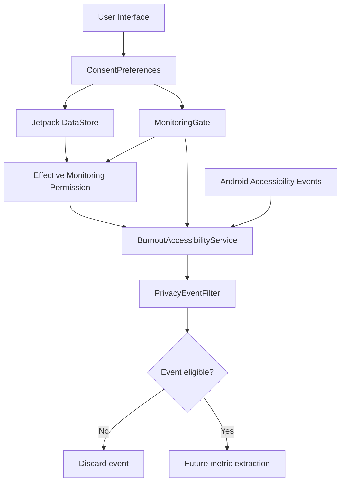

# Month 2 — Implementation and Architecture Report

**Project:** Burnout Detector: Passive Mobile-Based Mental Fatigue Detection Using Typing and Interaction Patterns

**Report date:** November 25, 2026

## 1. Objective

The objective of Month 2 was to establish the technical foundation of the Android research application, with particular emphasis on user consent, privacy protection, monitoring control, and safe accessibility event handling.

The implementation focuses on preparing a privacy-conscious prototype before introducing actual behavioral metric collection.

## 2. Development Environment

| Component | Technology |
|---|---|
| Platform | Android |
| Programming language | Kotlin |
| Development environment | Android Studio |
| User interface | Jetpack Compose |
| Preference storage | Jetpack DataStore |
| Event observation | Android AccessibilityService |
| Asynchronous processing | Kotlin Coroutines and Flow |
| Unit testing | JUnit |
| Version control | Git and GitHub |
| Physical test device | Samsung Galaxy S21 Ultra (SM-G998N), Android 15 |

## 3. Implemented Components

### 3.1 Research Consent Interface

A research consent interface was implemented using Jetpack Compose.

The interface presents the research purpose, planned behavioral metrics, privacy restrictions, and voluntary participation conditions.

Users must explicitly select a consent checkbox before proceeding to the application dashboard.

The consent interface distinguishes planned research functionality from the current prototype, which does not yet collect behavioral metrics.

### 3.2 Persistent Consent Management

The ConsentPreferences component uses Jetpack DataStore to persist two preferences:

- consent_accepted_at: timestamp of consent acceptance.
- monitoring_enabled: saved monitoring preference.

Accepting consent does not automatically activate monitoring.

Preference modifications are coordinated using a shared coroutine Mutex to serialize updates.

Consent withdrawal closes the monitoring gate before attempting to remove the stored consent timestamp.

### 3.3 Monitoring Controls

The application dashboard provides controls for enabling monitoring, pausing monitoring, and withdrawing consent.

The monitoring status is displayed as either "Monitoring requested" or "Monitoring paused."

The term "Monitoring requested" is used because the dashboard does not independently verify the active connection status of the AccessibilityService.

The dashboard also explains that monitoring must be manually enabled again after an application process or device restart.

### 3.4 AccessibilityService Prototype

BurnoutAccessibilityService was implemented to receive the following Android accessibility event categories:

- TYPE_VIEW_TEXT_CHANGED
- TYPE_VIEW_SCROLLED
- TYPE_WINDOW_STATE_CHANGED

These categories provide the foundation for future typing-related, scrolling, and application-switching metrics.

The corresponding metric-processing branches remain intentionally empty during Month 2.

The service does not extract or persist behavioral metrics at this stage.

### 3.5 Privacy Event Filtering

PrivacyEventFilter was implemented as a separate, independently testable component.

The filter rejects events when:

- Monitoring permission is unavailable.
- Android identifies the event as password-related.
- The package name is missing or blank.
- The event originates from Burnout Detector itself.
- The package belongs to the configured exclusion list.
- The event type is unsupported.

The exclusion list contains selected Android system and keyboard application packages.

The filter is an initial privacy safeguard rather than a comprehensive sensitive-application detection mechanism.

### 3.6 Immediate Monitoring Gate

MonitoringGate provides an in-memory monitoring permission mechanism using MutableStateFlow.

The gate is closed by default and uses synchronized operations to coordinate state changes.

A generation identifier is used to invalidate outdated activation requests. Closing the gate increments the generation, preventing an earlier activation request from reopening it using an obsolete identifier.

This mechanism reduces the risk of monitoring being unintentionally reactivated after a pause or withdrawal request.

### 3.7 Safe Restart Behavior

Effective monitoring permission depends on the following conditions:

1. A valid consent timestamp exists.
2. The saved monitoring preference is enabled.
3. The current process monitoring gate is open.

The in-memory gate is initialized as closed whenever a new application process is created.

Consequently, previously saved monitoring preferences cannot independently reactivate monitoring after a process restart.

### 3.8 Backup and Device-Transfer Protection

Android backup protection was configured using:

- android:allowBackup="false"
- Legacy full-backup exclusion rules.
- Modern cloud-backup exclusion rules.
- Device-transfer exclusion rules.

The merged manifest and installed application flags were inspected.

An Android Backup Manager request was also executed on the physical test device. The package-specific result confirmed that backup was not allowed.

Physical device-to-device migration was not experimentally tested.

### 3.9 Error Handling and Withdrawal Priority

The consent interface was updated to handle preference read and write failures.

When a preference read failure occurs, the monitoring gate is closed and the interface provides a retry option.

Consent withdrawal is available during ordinary monitoring preference updates. The withdrawal implementation closes the monitoring gate immediately, cancels and awaits the pending monitoring coroutine, and then attempts to remove persistent consent.

Normal withdrawal was successfully verified. Withdrawal during an intentionally pending activation operation requires further controlled testing.

## 4. Implemented System Architecture

The application follows a separation of responsibilities between its user interface, preference management, monitoring permission control, accessibility event observation, and privacy filtering.

### Main Components

| Component | Responsibility |
|---|---|
| MainActivity.kt | Consent interface, dashboard, monitoring controls and error feedback |
| ConsentPreferences.kt | Persistent consent and monitoring preference management |
| MonitoringGate.kt | Immediate in-memory monitoring permission and request invalidation |
| BurnoutAccessibilityService.kt | Accessibility event observation and permission enforcement |
| PrivacyEventFilter.kt | Event eligibility and privacy filtering |
| burnout_accessibility_config.xml | Accessibility service event configuration |
| AndroidManifest.xml | Application and service declarations and backup restrictions |
| backup_rules.xml | Legacy backup exclusions |
| data_extraction_rules.xml | Modern cloud-backup and device-transfer exclusions |

### Monitoring Permission Flow

The metric extraction component represents planned Month 3 functionality and is not implemented in the current prototype.

## 5. Privacy-by-Design Principles

The current implementation incorporates the following principles:

- Explicit user consent before monitoring.
- Monitoring disabled by default.
- Immediate monitoring gate closure.
- Manual reactivation after process restart.
- Minimal persistent preference storage.
- Restricted accessibility event categories.
- No access to actual typed text or accessibility node content in the implemented service.
- No screenshot collection.
- No persistent storage of application package names.
- No declared Internet permission.
- Android backup restrictions.
- Fail-closed monitoring behavior when the permission observer encounters an error.

These safeguards reduce privacy risks but do not constitute a complete security or regulatory compliance assessment.

## 6. Current Implementation Scope

At the end of Month 2, the application provides a functional consent and monitoring-control prototype.

The following functionality has not yet been implemented:

- Behavioral metric extraction.
- Room database integration.
- Five-minute feature aggregation.
- Personalized behavioral baseline calculation.
- Anomaly detection.
- Fatigue assessment.
- Behavioral data export and deletion.

These components will be introduced during subsequent development stages.

## 7. Conclusion

Month 2 established the Android application foundation and its initial privacy architecture.

The implementation provides explicit consent management, persistent preferences, immediate monitoring controls, accessibility event filtering, safe process restart behavior, and backup restrictions.

The prototype is ready to proceed to controlled development of behavioral metric extraction and local database integration, subject to the documented testing limitations and further privacy verification before research participant deployment.
