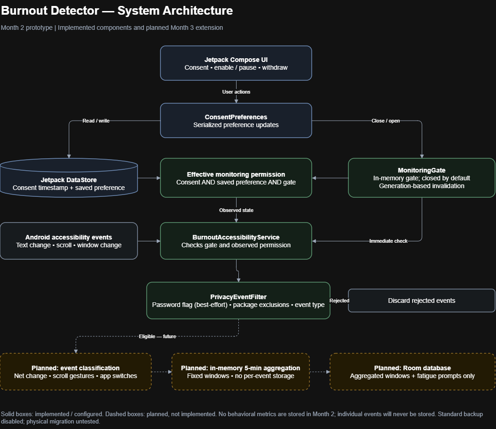

# Burnout Detector — System Design

## 1. System Overview

Burnout Detector is a native Android application designed to investigate the feasibility of detecting early signs of short-term mental fatigue through passive smartphone interaction monitoring.

The application is developed using Kotlin and Android Studio (minimum SDK: API 28, Android 9). It uses Android's AccessibilityService API to observe interaction events and extract behavioral metadata: typing speed, correction (backspace) frequency, scrolling activity, and application switching frequency.

The collected information is processed locally on the device and aggregated into five-minute time windows. The system will establish a personalized behavioral baseline and use lightweight rule-based anomaly detection to identify deviations from the user's typical interaction patterns. These deviations are evaluated against fatigue ratings that the user reports in the application.

Privacy is a central design requirement. Android delivers event text to the accessibility service, but the application never reads, logs, or stores it: only the event type, timestamp, and character counts are extracted. Passwords, message contents, and screenshots are never collected. Behavioral measurements are stored locally using Room, an abstraction layer over SQLite, and are never transmitted automatically.

The application provides users with information about the monitoring process, controls for stopping monitoring, and options for deleting or explicitly exporting their data.

The system is intended as an exploratory research prototype rather than a medical diagnostic tool. Its effectiveness will be evaluated through technical testing on multiple devices and comparison with self-reported mental fatigue measurements.

## 2. Functional Requirements

Functional requirements describe the operations that the Burnout Detector application must support. Priorities follow the MoSCoW scheme (Must, Should, Could). The last column links each requirement to the research questions it supports.

| ID | Requirement | Description | Priority | Related RQ |
|---|---|---|---|---|
| FR01 | User information and consent | The application must explain what is and is not collected before monitoring starts, and the user must explicitly enable the accessibility service in the system settings. | Must | — |
| FR02 | Interaction monitoring | The application must receive text-change, scroll, and window-change accessibility events while monitoring is enabled. | Must | RQ1 |
| FR03 | Sensitive field exclusion | The application must ignore events from password fields and from its own user interface. | Must | RQ1 |
| FR04a | Typing speed | The application must derive typing speed from the timing of text-change events and their net character change (`addedCount − removedCount`), without reading textual content. | Must | RQ1, RQ2 |
| FR04b | Correction frequency | The application must detect deletions (net change of −1) and compute a backspace ratio. Multi-character replacements (e.g., autocorrect) are counted separately. | Must | RQ1, RQ2 |
| FR05 | Scroll monitoring | The application must record scroll events and, where available, their scroll distance. | Should | RQ1, RQ2 |
| FR06 | Application switching | The application must count transitions between applications, excluding keyboard and system UI windows. Package names are not stored. | Should | RQ1, RQ2 |
| FR07 | Local storage | The application must store behavioral measurements in a local Room database. | Must | — |
| FR08 | Feature aggregation | The application must aggregate collected measurements into five-minute time windows. | Must | RQ2 |
| FR09 | Fatigue self-report | The application must prompt the user several times per day to rate their current fatigue on a standardized scale and store each rating with a timestamp. | Must | RQ2, RQ3 |
| FR10 | Monitoring status | The application must show whether monitoring is active and how much data has been collected. | Should | — |
| FR11 | Monitoring controls | Users must be able to stop and restart monitoring. | Must | — |
| FR12 | Data deletion | Users must be able to delete all locally stored data. | Must | — |
| FR13 | Data export | Users must be able to explicitly export their stored measurements (e.g., as a CSV file). | Must | RQ2, RQ3 |
| FR14 | Personalized baseline | The application must establish an individual behavioral baseline after an initial observation period. | Must | RQ3 |
| FR15 | Anomaly detection | The application must compare recent windows with the baseline using lightweight rules. | Must | RQ3 |
| FR16 | Fatigue feedback | The application could display fatigue-related indicators and optional break suggestions. | Could | — |

FR01–FR07 and FR10–FR12 are implemented in Month 2, FR08 and FR13 in Month 3, and FR09, FR14–FR16 in Month 4.

**Feasibility note for FR04a–b.** Android accessibility events do not expose individual keypresses. They do, however, report how many characters were added and removed in each text change. Whether these counts are reliable across device manufacturers and keyboard applications (e.g., Samsung Keyboard and Gboard) is investigated under RQ1 and documented in the device testing report.

## 3. Non-Functional Requirements

Non-functional requirements describe the quality, privacy, reliability, and performance characteristics of the system. Each is stated so that it can be verified.

### NFR01 — Privacy
The application must never read, log, or store the text content of accessibility events. Only event type, timestamp, and character counts are extracted. Password fields are ignored entirely (FR03).
*Verification:* code review of the event processor; inspection of the exported database.

### NFR02 — Security
All data must be stored in the application's private storage and must not be transmitted over the network. The application does not request the `INTERNET` permission.
*Verification:* inspection of `AndroidManifest.xml`.

### NFR03 — Performance
Event handling must not block the main thread. Database writes must run on a background thread. Battery consumption attributed to the application should stay below approximately 3% per day under normal use.
*Verification:* code review; Android battery usage statistics during device testing.

### NFR04 — Reliability
Events with missing or unexpected fields must be skipped without crashing and counted in a diagnostics counter, so that data loss is visible rather than silent.
*Verification:* diagnostics counter in the status screen; device testing.

### NFR05 — Usability
The consent and status screens must explain data collection in plain language, and stopping monitoring or deleting data must take no more than two taps from the main screen.
*Verification:* walkthrough with test participants.

### NFR06 — Compatibility
The application must run on Android 9 (API 28) and later, and must be tested on at least two devices from different manufacturers (e.g., Samsung and Google Pixel) to compare event availability.
*Verification:* device testing report.

### NFR07 — Maintainability
Event collection, event processing, database access, and user interface logic must be implemented as separate components (see Section 4).
*Verification:* project structure.

### NFR08 — Transparency
The application must state that its fatigue-related outputs are experimental indicators and not a clinical diagnosis.
*Verification:* consent and feedback screens.

### NFR09 — Data retention
Individual interaction events must never be written to storage; only aggregated five-minute windows are stored. All data must be deletable by the user at any time (FR12). Participants' data is retained only for the duration of the study.
*Verification:* inspection of the database schema and contents.

## 4. Architecture

The application is organized as a pipeline of five layers. Each layer has one responsibility, which supports maintainability (NFR07) and makes the privacy boundary explicit.

| Layer | Component | Responsibility |
|---|---|---|
| 1. Android system | — | Emits accessibility events for text changes, scrolling, and window changes |
| 2. Event collection | `BurnoutAccessibilityService` | Receives events from the system and forwards them to the processor |
| 3. Event processing | `EventProcessor` | Extracts type, timestamp, and character counts; filters password fields, own-app events, and system windows; discards everything else. **This is the privacy boundary:** no text passes beyond this layer |
| 4. Storage | Room database (`AppDatabase`, DAOs) | Stores aggregated five-minute windows and fatigue ratings on the device. Individual events are never stored |
| 5. Presentation | Compose screens | Consent, status, fatigue rating prompt, export, and delete |

## 5. Data Flow

1. The user types, scrolls, or switches apps.
2. Android sends an `AccessibilityEvent` to `BurnoutAccessibilityService`.
3. `EventProcessor` checks the event type and source. Events from password fields, from the application itself, or from system windows are discarded.
4. For accepted events, the processor classifies the event (typed character, deletion, replacement, scroll, or application switch) and updates running totals **in memory**. Only numeric values are used: the net character change, timestamps, and, where available, scroll distance.
5. Individual events are never written to storage. This protects against cases where a password field is not recognized by Android (see `testing-report.md`, Section 8.6).
6. Every five minutes, the in-memory totals are converted into an `InteractionWindow` containing the computed features (typing speed, backspace ratio, scroll gestures, app switches), which is written to the Room database on a background thread. The totals are then reset (NFR09).
7. Fatigue ratings entered by the user are stored as `FatigueReport` records and later linked to the windows from the preceding 30 minutes.

## 6. Database Design

The database schema, entity definitions, and relationships are described in [`database-design.md`](database-design.md).

## 7. Privacy Design

Consent, data minimization, the privacy boundary, retention, export, and deletion are described in [`privacy-design.md`](privacy-design.md).
